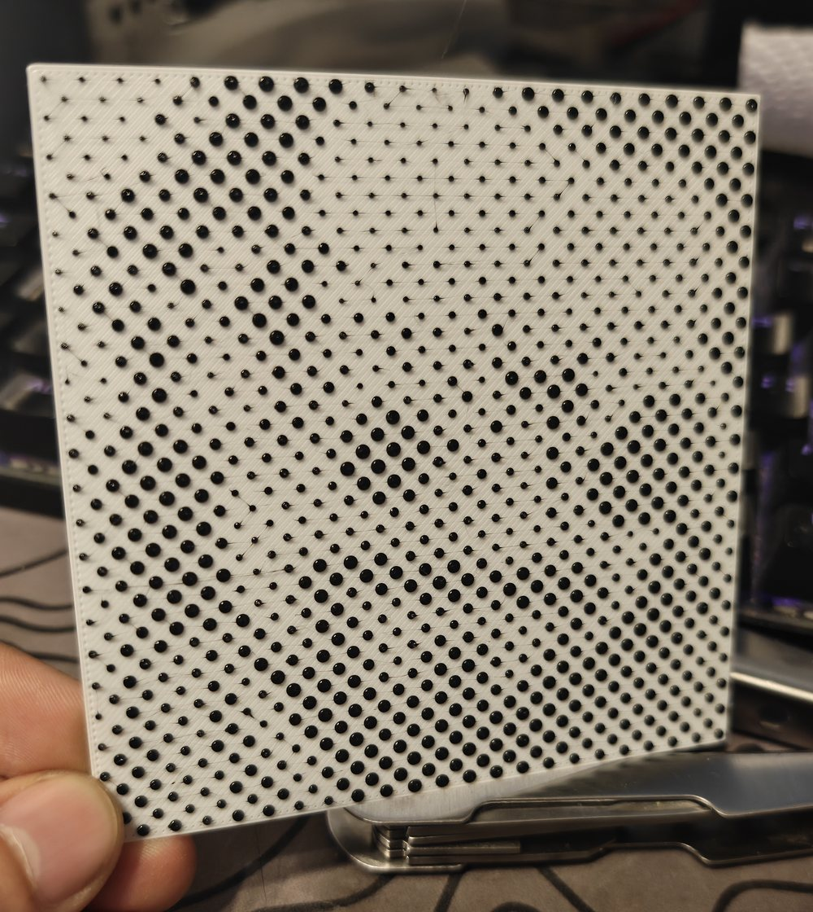

# Dot Art

Turn an uploaded picture into a printed halftone: a grid of dots whose size carries the tone, like newspaper print, in a second color on a base.

*A first test print, not a finished result: 100 mm wide, 3.2 mm spacing, on a Bambu Lab X1 Carbon. Thin strings between the blobs are visible.*

Requires OrcaSlicer 2.5.0 or later.

Also on [Orca Cloud](https://cloud.orcaslicer.com/app/plugins/shared-plugins/3ec4b372-e6be-4365-b2c0-a5676d124fb0).
